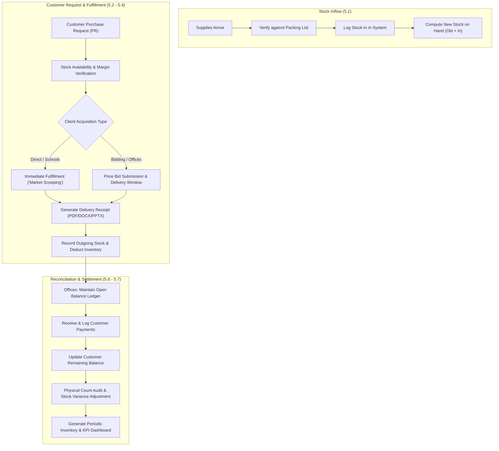

# 📦 PMS Inventory System — Project Architecture & Requirements Proposal

Comprehensive architectural foundation, data modeling, business flow mapping, and functional blueprint for the **PMS School and Office Supplies Trading** inventory tracking and delivery monitoring system.

---

## 🎯 Executive Summary & Problem Context

* **Client:** PMS School and Office Supplies Trading (School, Office, and Janitorial Supplies).
* **System Type:** Single-user, single-branch, web-based inventory tracking and delivery monitoring platform.
* **The Core Friction:** The client currently monitors all incoming stock, outgoing stock, and balances on manual stock cards. Periodic monthly and yearly inventory balancing is slow and error-prone. Customer delivery logs and office balance debts are scattered across physical receipts without centralized accountability.
* **Target Objective:** Deliver an ergonomic system that eliminates physical stock cards through automated on-hand computation, manages office bidding cycles alongside school market-scooping orders, generates multi-format delivery receipts (**PDF**, **DOCX**, **PPTX**), and presents live revenue/stock KPIs.

---

## 🏗️ System Architecture & Technology Stack

Drawing from the rapid-prototyping principles of [[Zero to Live URL (Elvin Ray)]] and the clean MVC structuring of [[ZCMC Referral System MVP - Planned Architecture|Laravel architectural patterns]]:

| Component | Proposed Technology | Architectural Justification |
| :--- | :--- | :--- |
| **Backend Engine** | **Laravel (PHP)** | Robust Eloquent ORM, built-in session auth, clean schema migrations, and native input validation for CRUD-heavy workflows. |
| **Database** | **MySQL** | Strict relational integrity across stock movement logs, customer accounts, payment ledgers, and delivery receipts. |
| **Presentation Layer** | **Blade Templates + TailwindCSS / Clean CSS + Minimal Vanilla JS** | Lightweight, responsive interface following [[Build client ready website fast with Claude (Jlo Edios)|rapid UI best practices]] without the unnecessary overhead of heavy SPA frontends. |
| **Document Generator** | **DomPDF / PHPWord / PHPPresentation** | Server-side rendering of Delivery Receipts in three mandatory client formats (**PDF**, **DOCX**, **PPTX**). |
| **Deployment Mode** | Localhost Web Server (XAMPP / Herd / Docker) or Dedicated VPS | Single-user operational perimeter with automated local database backup scripts. |

---

## 🔄 Core Business Process Workflows

---

## 🗄️ Relational Data Schema (Entities)

| Entity | Attributes & Types | Constraints & Relationships |
| :--- | :--- | :--- |
| `categories` | `id` (PK), `name` (String: School, Office, Janitorial) | 1-to-Many with `items` |
| `items` | `id` (PK), `category_id` (FK), `name`, `unit`, `price` (Decimal), `low_stock_threshold` (Int), `status` (Enum: active, archived) | Belongs to `category`; Has many movements |
| `customers` | `id` (PK), `name`, `type` (Enum: school, office), `contact_person`, `phone`, `address` | 1-to-Many with `deliveries`, `payments` |
| `stock_ins` | `id` (PK), `item_id` (FK), `quantity` (Int), `date` (Date), `remarks` | Automatically increments item stock balance |
| `deliveries` | `id` (PK), `customer_id` (FK), `receipt_number` (String, Unique), `order_type` (Enum: direct, bidding), `total_amount` (Decimal), `delivery_date` (Date), `status` (Enum: pending, delivered, cancelled) | Has many `delivery_items` |
| `delivery_items` | `id` (PK), `delivery_id` (FK), `item_id` (FK), `quantity` (Int), `unit_price` (Decimal) | Locked snapshot of unit price at delivery time |
| `payments` | `id` (PK), `customer_id` (FK), `delivery_id` (FK, Nullable), `amount` (Decimal), `payment_date` (Date), `remarks` | Deducts from customer's cumulative balance |
| `stock_adjustments`| `id` (PK), `item_id` (FK), `system_quantity` (Int), `counted_quantity` (Int), `variance` (Int), `adjustment_date` (Date), `reason` (Text) | Enforces audit trail for physical inventory counts |
| `users` | `id` (PK), `username`, `password` (Hashed), `remember_token` | Single owner account security barrier |

---

## 📋 Functional Requirements Matrix

* **FR-01 (Item Catalog & Classification):** Multi-category categorization (School Supplies, Office Supplies, Janitorial Products) with item unit types and archiving support.
* **FR-02 (Snapshot & Adjustable Pricing):** Dynamic price configuration that updates future operations without retroactively modifying historical deliveries.
* **FR-03 & FR-04 (Automated Stock In/Out Engine):** Complete digital replacement of physical stock card calculation loops; automated stock subtraction upon delivery dispatch.
* **FR-05 (Stock Card Digital Ledger):** Audit log showing chronologically ordered stock movement per individual item (Date, Transaction Type, In/Out Qty, Balance).
* **FR-06 (Threshold Alerting):** Visual badges and warning indicators for items dropping below defined safety thresholds.
* **FR-07 to FR-10 (Customer & Balance Tracking):** Dedicated tracking for Office bidding cycles vs. School market-scooping orders; live outstanding accounts receivable balance computation.
* **FR-11 (Multi-Format Receipt Engine):** Exportable Delivery Receipts formatted for printing or distribution in **PDF**, **DOCX**, and **PPTX**.
* **FR-12 & FR-14 (Analytics & Periodic Reports):** Executive dashboard detailing gross revenue, inventory asset valuation, monthly/annual movement reports (Beginning, Inflow, Outflow, Ending balance).
* **FR-13 (Physical Count Auditing):** Dedicated physical count input screen calculating system-to-count variance with documented adjustment logs.

---

## ⚡ Engineering & Agentic Workflow Directives

In accordance with our [[High-Performance Terminal Agent Architecture Template (Specification & Directives)|Executive Terminal Agent Guidelines]] and [[You are using AI the wrong way (Jaydee Ballajo)|Karpathy-compliant CLI practices]]:
1. **YAGNI & Anti-Bloat:** Keep the architecture strictly single-user and single-branch. Do not introduce speculative multi-tenant scopes or complex microservices.
2. **Surgical Verification:** Every schema migration and stock calculation routine must be accompanied by automated unit tests validating invariant stock math (`Beginning + In - Out == Ending`).
3. **Receipt Generation Isolation:** Package receipt renderers (PDF, DOCX, PPTX) into isolated service classes adhering to a shared export contract.

---

## ⚠️ Key Clarifications & Client Confirmation Checklist

1. **Payment Methods & Terms:** Determine whether schools also run on credit terms or if balances apply exclusively to offices.
2. **Delivery Receipt Layout:** Validate exact company header, logo placement, itemized table columns, and authorized signature blocks.
3. **Repeat Order Automation:** Clarify whether the 3-month recurring cycle should proactively trigger automated alerts on the dashboard.
4. **Initial Data Ingestion:** Identify estimated volume of beginning items, opening stock levels, and existing school/office customer records.

---

## 🔗 Second Brain & Cross-Domain Connections

* 🧭 **[[Hi, I'm Jm|Vault Home Index]]** — Master vault index and entry point.
* 🚀 **[[Projects & Software Development (Map of Content)|Projects MOC]]** — Central index of all engineering projects and deliverables.
* 🏥 **[[ZCMC Referral System MVP - Planned Architecture]]** — Sister project using Laravel backend architecture and pragmatic schema design.
* 💡 **[[Panel Discussion - Hack to Win]]** — Requirements scoping, rapid MVP planning, and software competition fundamentals.
* ⚡ **[[Build client ready website fast with Claude (Jlo Edios)]]** — Prototyping speed and clean UI patterns.
* 🤖 **[[Agentic Workflow The Future of Intelligent Automation - Anti Gravity (Larry Mark Somocor)]]** — Autonomous workflow paradigms and terminal execution patterns.
* 💻 **[[School & Computer Science (Map of Content)|School & Computer Science]]** — Academic foundations and software engineering coursework.
