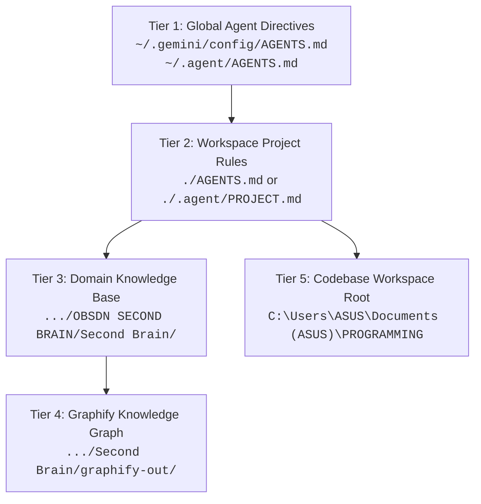

# 🤖 Antigravity Agentic Environment & Skill Architecture

## 1. Executive Summary & Philosophy
This document records the definitive configuration, engineering protocols, multi-tiered memory hierarchy, and modular skill ecosystem governing the **Google Antigravity (AGY)** terminal agent setup on this workstation.

The operating philosophy enforces Karpathy-compliant execution:
- **Zero speculative bloat (YAGNI):** Standard library and native OS tooling first.
- **Surgical changes:** Focused modifications with zero collateral reformatting.
- **Goal-driven verification:** Behavioral pass/fail validation prior to task completion.
- **Aggressive token conservation:** Subagent delegation, output throttling, and surgical reading to prevent hitting API limits.

---

## 2. Multi-Tiered Memory & Storage Architecture



| Tier | Tier Level | File Path / Root Location | Operational Scope |
| :--- | :--- | :--- | :--- |
| **Tier 1** | Global Directives | `C:\Users\ASUS\.gemini\config\AGENTS.md`<br/>`C:\Users\ASUS\.agent\AGENTS.md` | Machine-wide system rules, executive tone, security mandates, and anti-slop gates. |
| **Tier 2** | Workspace Rules | `./AGENTS.md` or `./.agent/PROJECT.md` | Repository-specific conventions, build commands, and local contracts. |
| **Tier 3** | Domain Knowledge Base | `C:\Users\ASUS\Documents (ASUS)\JM IMPORTANT DOCUMENTS\OBSDN SECOND BRAIN\Second Brain` | Curated documentation, architectural proposals, sermon notes, and study notes. |
| **Tier 4** | Graphify Knowledge Index | `.../Second Brain/graphify-out/` | Pre-parsed AST (`graph.json`) and report (`GRAPH_REPORT.md`). Synced via `graphify update .`. |
| **Tier 5** | Codebase Root | `C:\Users\ASUS\Documents (ASUS)\PROGRAMMING` | Root for all programming projects (`PRIOJECT FILES`, `WMSU PROJECTS`, `Hermes`, etc.). |

---

## 3. Modular Skill Matrix (Installed Capabilities)

All custom skills reside in:  
`C:\Users\ASUS\.gemini\antigravity-cli\skills\`

### 3.1 Token Preservation & Optimization Suite
| Skill | Directory | Primary Role & Enforcement |
| :--- | :--- | :--- |
| **`token-sentinel`** | `skills/token-sentinel/` | Intercepts verbose terminal outputs. Caps stdout to $\le 50$ lines; redirects heavy logs to `scratch/*.log`. |
| **`lazy-reader`** | `skills/lazy-reader/` | Forbids unconstrained file reads. Enforces ripgrep symbol isolation (`StartLine`/`EndLine`) before calling `read_file`. |
| **`context-compactor`** | `skills/context-compactor/` | Checkpoints progress in `scratch/state.md` and advises running `/compact` at key task milestones to prevent quadratic context blowup. |
| **`subagent-summarizer`** | `skills/subagent-summarizer/` | Isolates broad multi-file searches inside lightweight subagents (`flash`), returning only concise summaries to the main session. |

### 3.2 Engineering, Testing & Quality Assurance
| Skill | Directory | Primary Role & Enforcement |
| :--- | :--- | :--- |
| **`karpathy-verifier`** | `skills/karpathy-verifier/` | Enforces simplicity-first, YAGNI, standard libraries, and autonomous verification loops before closing tasks. |
| **`test-driven-enforcer`** | `skills/test-driven-enforcer/` | Autonomous testing copilot that locates test suites and executes regression checks before committing code. |
| **`ponytail`** | `skills/ponytail/` | Laziness Ladder evaluator: strips premature abstractions and unnecessary external dependencies. |
| **`git-sentinel`** | `skills/git-sentinel/` | Gatekeeper against credential leaks, unstaged accidental commits, and unauthorized git operations. |

### 3.3 Knowledge Management & Integration
| Skill | Directory | Primary Role & Enforcement |
| :--- | :--- | :--- |
| **`obsidian-vault-manager`** | `skills/obsidian-vault-manager/` | Enforces YAML frontmatter, wikilinks, MOC updates, and triggers automated `graphify update .`. |
| **`obsidian-vault-refactor`** | `skills/obsidian-vault-refactor/` | Vault structural maintenance: triages `00 - Inbox`, clears orphans, and rewires links atomically. |
| **`code-vault-bridge`** | `skills/code-vault-bridge/` | Bi-directional synchronization between codebases in `PROGRAMMING` and architecture specs in `Second Brain`. |
| **`graphify-navigator`** | `skills/graphify-navigator/` | Fast AST lookup using `graph.json` to prevent blind file scans across the Obsidian vault. |
| **`self-discovery-analyst`** | `skills/self-discovery-analyst/` | Structured cognitive reflection and personality profiling inside Obsidian. |

### 3.4 UI/UX & Design Systems
| Skill | Directory | Primary Role & Enforcement |
| :--- | :--- | :--- |
| **`ui-ux-pro-max`** | `skills/ui-ux-pro-max/` | Generates 60-30-10 color distributions, typography hierarchies, and complete component states (`rest`, `hover`, `active`, `focus-visible`). |
| **`hallmark`** | `skills/hallmark/` | Anti-AI-slop gatekeeper: bans generic purple gradient blobs, repetitive 3-column bento cards, and tracked-caps pill overdose. |

---

## 4. Standard Operational Protocols

### 4.1 Knowledge Base Synchronization
Whenever a `.md` note is added, renamed, or modified in the vault:
1. Ensure the parent Map of Content (MOC) is linked.
2. Execute Graphify update to maintain topological freshness:
   ```powershell
   graphify update "C:\Users\ASUS\Documents (ASUS)\JM IMPORTANT DOCUMENTS\OBSDN SECOND BRAIN\Second Brain"
   ```

### 4.2 Codebase Isolation
- Code implementations, node modules, build targets, and git repositories must **never** be placed inside the Obsidian Second Brain.
- All software artifacts reside under `C:\Users\ASUS\Documents (ASUS)\PROGRAMMING`.

---

## 5. Connections & Related Notes
- [[🚀 Projects & Software Development (Map of Content)]]
- [[💭 Personal Knowledge Hub (Map of Content)]]
- [[💻 School & Computer Science (Map of Content)]]
- [[🤖 Agentic System Architecture & Skill Verification]]
